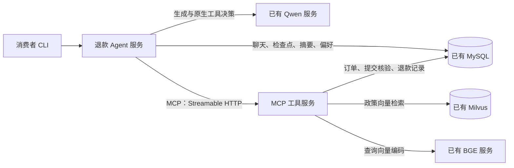

# 退款 Agent：MCP 接入与两服务部署设计

日期：2026-11-19  
性质：已纳入 2026-11-19 用户确认的设计基线，两个退款应用尚未实施  
关联：[主设计](spec.md)、[存储与记忆](storage-memory.md)、[上下文压缩](context-compression.md)

## 1. 两个应用服务的含义

用户已确认集群中由“退款 Agent 服务 + MCP 工具服务”两个应用组成，分别部署为独立 Deployment / Service；这里的两个是应用部署单元，不是系统中所有逻辑 Agent 的数量，也不包含已有数据库和模型服务。职责划分记录在 [ADR-0006](../../docs/adr/0006-refund-agent-mcp-service-boundary.md)。

- `refund-agent`：MCP Host，内部持有 MCP Client；负责消费者会话、LangGraph、Plan / Execute、DeepAgent、ReAct、上下文压缩、授权状态和最终回复。
- `refund-mcp`：MCP Server，提供有边界的订单、政策检索与模拟退款工具；以普通业务代码执行，不增加自主规划模型。PolicyAgent 和 OrderAgent 仍是退款 Agent 应用内的逻辑子 Agent，不单独部署。

消费者 CLI 对话方式保留；退款应用部署到集群后，可由轻量 CLI 客户端访问其对话入口。CLI 的连接协议、入口形式和具体 Service 名称由实现者在两服务拓扑下确定，不新增浏览器前端或第三个常驻应用。

两个服务和 CLI 的应用代码统一位于仓库根目录 `order-demo/`，目录内部按职责组织。已部署依赖的连接信息与验证状态见[环境证据](storage-memory.md#7-已查到的环境证据)。

已有 MySQL、Milvus、Qwen、BGE 继续作为依赖，MCP Server 不是这些服务的替代品。技术上 MCP 定义工具和上下文交换方式，不负责决定退款业务策略或管理消费者聊天记忆。

## 2. 已选拓扑

采用 Streamable HTTP：两个应用在集群内独立运行，明确展示客户端与服务端的协议边界。第一版使用单一 MCP Server，不拆成订单、政策、退款等多个常驻服务器。

另一种可行方式是 stdio，由退款应用启动同机子进程，适合本地演示，但不符合本轮期望的两个独立集群应用。具体 SDK 和协议代际需要按兼容性锁定，不能将不同代际的初始化、能力发现或认证字段混用。

## 3. MCP 放在工具接入层

主链保持：LangGraph 控制状态与节点；Plan / Execute 管理调查计划；DeepAgent 委派专用子 Agent；ReAct 选择只读工具并观察结果；RAG 提供政策证据。MCP 将原本的应用内业务工具调用变成对独立工具服务的协议调用。

模型输出的原生工具调用由 Host 接收，经适配器转发 MCP，再把经过校验的工具观察返回模型；模型自身不直接连接数据库或构造任意 MCP 网络请求。MCP 也不要求再增加一层 Planner 或一个新的自主 Agent。

## 4. 工具与存储边界

| MCP 工具 | 调用者 | 服务端工作 | 返回契约 |
| --- | --- | --- | --- |
| `get_order` | OrderAgent 的只读工具适配器；固定业务复核节点 | 按可信消费者身份查询 MySQL 订单 | `OrderQueryResult` |
| `search_policy` | PolicyAgent 的只读工具适配器 | 按目录修订和检索范围召回并重排候选，普通咨询允许 FAQ 与正式条款一起参与 | `PolicySearchResult`，包含候选来源及目录修订号。重排超时或失败时返回检索失败。 |
| `get_refund_result` | 固定业务节点，处理已退款或回执不明 | 按消费者和订单核对原退款记录 | `RefundLookupResult` |
| `submit_mock_refund` | 仅固定 LangGraph 退款节点 | MySQL 事务内复核并创建唯一模拟退款记录 | `RefundResult` |

`get_refund_result` 用于直接核对已存在的业务记录，不新增到账进度轮询。`search_policy` 返回检索候选及来源，不能仅因工具成功就判定政策证据充分；Host 仍执行现有证据核验。

用户已确认退款业务工具统一通过 MCP 调用。退款 Agent 直接使用 MySQL 管理聊天原文、摘要、偏好和 LangGraph 检查点。MCP Server 管理订单、退款记录和政策检索。两个服务引用 `order-demo/model/`，共享表定义和连接配置，并分别管理进程内的数据库连接。具体分工见[数据库表结构](database-design.md)。

政策发布和演示重置通过显式管理入口运行。发布写入本演示政策 collection，确认可检索后更新 MySQL 政策发布目录。MCP 读取目录并按版本提供候选与正式条款，Host 根据本轮回执回答和核验引用。见 [ADR-0010](../../docs/adr/0010-refund-policy-publication-and-evidence.md)。

## 5. 读写权限与可信身份

为落实已确认的只读调查与固定执行边界，本稿采用以下实现方案：同一 MCP Server 提供调查读取身份与受控执行身份，服务凭据由部署配置管理。Host 维护对应的工具访问配置，子 Agent 只拿到其当前任务允许的只读工具；退款执行身份仅保留在固定应用节点中。具体 SDK 鉴权接入与凭据键名由实现者决定，不新增消费者登录或身份平台。

服务器在每次调用时检查调用身份与权限。仅从模型工具列表里隐藏 `submit_mock_refund` 不足以形成执行边界，服务端也须拒绝读取身份执行写入；工具的只读提示或副作用标记不能代替权限检查。

当前仍为固定模拟消费者，不增加消费者登录注册或 OAuth 平台建设。服务凭据与消费者身份分别管理：经认证的调用上下文映射到允许的模拟消费者，`user_id` 不由模型任意填写，普通 MCP 客户端名称、thread_id 和会话标识也不能当作身份凭据。

Host 受控会话节点根据消费者明确表达维护当前会话的办理意图。固定节点校验通过、准备发送时，在 MySQL 提交记录保存订单、会话及本次授权的原始消息引用。MCP Server 的固定事务按幂等键锁定该提交，核对订单、会话消费者和授权是否已撤销，再独立复核归属、业务资格、金额和退款唯一性。授权的自然语言识别由 Host 承担。

Host 处理取消或换单时更新当前会话的办理意图。提交已保存时，Host 锁定同一提交记录写入撤销时间，结果待核对时继续拦截同订单。旧提交关闭后，原会话恢复待办须有明确继续的指令，新会话发起新申请须明确指定订单并要求办理。新提交引用当前会话的本次指令，成功退款以幂等键关联实际执行的提交。见 [ADR-0008](../../docs/adr/0008-refund-authorization-per-dispatch.md)。

## 6. 输入输出契约与事件关联

工具输入输出使用具名数据模型生成 Schema，Host 和 Server 共享或严格对齐契约；在 MCP 边界完成解析与校验，不在后续内部逻辑反复处理任意字典。

- `GetOrderRequest`：只包含受约束的订单号；消费者身份来自受认证上下文。
- `SearchPolicyRequest`：沿用 `query` 和 Host 控制的 `mode`，允许 Host 在后续读取时传回本轮目录修订号。首次读取由 MCP 选定版本，集合、向量维度和检索条件由服务端负责。
- `PolicySearchResult`：沿用 `status`、`event_id` 和 `candidates`，成功时携带目录修订号，包括候选为空的情况。候选含文档 ID、标题、版本、条目编号、条目类型和原文。
- 普通咨询的全部重排候选参与选答。选中已发布 FAQ 时直接使用其答案并引用该 FAQ，选中正式条款时使用条款原文及出处。首轮成功但没有适用候选时，Host 沿用同一目录修订再调用一次仅限正式条款的 `search_policy`。认证使用配置文件中的 `mcp.read_token`。
- Host 按事件 ID、文档 ID、版本、条目编号和类型从本轮成功检索回执核验出处，取回执标题及原文。订单资格与退款办理采用正式条款作为政策依据。首次成功回执确定本轮政策版本快照，后续检索沿用该修订号。15 的 MCP 使用演示版本生成修订号，16 改用 MySQL 目录，沿用同一工具契约。
- `GetRefundResultRequest`：订单号必填，Host 已知的业务标识可空，仅用于关联核对；新会话即使不知道旧幂等键也可以按本人订单读取原结果。`RefundLookupResult` 明确区分找到原结果、未找到和查询不可用；未找到不当然证明先前提交一定未发生。
- `SubmitMockRefundRequest`：`order_id` 和由固定节点生成的 `idempotency_key`。Server 从经认证的上下文取得消费者身份，从提交记录核验本次授权，从订单读取实付金额。
- `RefundResult`：沿用 simulated_succeeded / already_refunded / denied / failed / unconfirmed 语义，成功结果必须对应真实记录。

模型原生工具调用 ID、MCP 请求标识、应用 trace ID、消费者会话 ID 和业务幂等键各自标识不同记录。重连后以 MySQL 提交和退款记录确定业务状态。

新退款写入调用前，Host 先确认最终政策核验事件已持久保存，再以同一 `trace_id` 和幂等键将订单、会话、来源消息及发送状态保存到 `refund_dispatches`。两次保存都成功后才能发送写调用。最终政策核验事件保存失败或无法确认时，暂停本次新提交。查单、查看已有结果和核对旧提交照常进行。已发送却未收到可信结果时先只读核对，checkpoint 和 SDK 都不得自动重发。见 [ADR-0009](../../docs/adr/0009-refund-policy-evidence-before-dispatch.md)。

按所选 SDK 支持方式读取结构化工具结果并校验 Schema；供模型阅读的文本观察由已校验对象生成，不能只解析自然语言“成功”作为业务凭据。连接、协议、工具执行异常与业务拒绝分别记录和呈现。

## 7. 正常退款的一次完整往返

1. Host 读取 MySQL 会话和当前偏好，按预算组装上下文并识别办理意图。
2. Planner 产生查询订单与检索政策的调查步骤。
3. DeepAgent 委派 OrderAgent；ReAct 选择 `get_order`，Host 经 MCP 调用服务端，读取 MySQL 并返回真实工具观察。
4. Replan 根据观察继续政策任务；PolicyAgent 通过 MCP 的 `search_policy` 调用 BGE 与 Milvus，Host 校验政策依据。
5. 写入前的引用、授权和规则核验通过后，固定业务节点先持久保存最终政策核验事件，再保存带本次授权证据的提交，最后经受控 MCP 调用 `submit_mock_refund`。
6. MCP Server 在事务内锁定提交与订单，核对提交的授权状态与已有退款，确定实际支付金额并创建唯一退款记录。
7. Host 校验 `RefundResult`，用确定性模板输出订单、金额和模拟退款单号，并附已核验政策说明。

该正常案例会实际经过原五项技术和新增 MCP；MCP 使用证据是协议发现、跨进程工具调用及关联结果，不用日志标签代替真实调用。

## 8. 故障、重启和重置

连接失败、协议不兼容或 Schema 不匹配时，停止依赖该工具的流程并说明。读取失败不伪装为订单不存在或政策不支持；Milvus 无依据继续沿用停止办理规则。

退款工具已发送但返回丢失时，按业务标识查询原退款记录。有已核验原结果则返回，仍不确定则标记待核对并拦截同订单的后续提交。演示维护命令与 MCP 退款事务使用同一提交记录锁，查无退款时在该事务中关闭旧提交。其他订单照常办理。应用重启只恢复历史与待办，明确继续后按当前提交状态重新查询与核验。完整恢复规则见[数据库表结构](database-design.md#维护核对与恢复)。

所选 SDK / 适配器的自动回合与重试也必须计入这条边界，不能只在业务代码中删除显式 retry。已核查的旧 SDK 高层 `Client.call_tool()` 包含需要进一步输入的自动回合以及协议头不匹配时重新列工具并重发的路径；退款执行链须选择或配置满足受控发送语义的调用方式，并验证底层不会在结果不明时自行重新提交。

图运行期间必须处于有效 MCP Client 生命周期中，退出时按 SDK 约定关闭连接；Client、HTTP 连接和凭据不序列化进 LangGraph checkpoint。具体长连接或按调用建立连接的选择由锁定适配器决定，不能跨用户混用身份，也不能把 MCP 连接恢复当作消费者会话恢复。

显式演示重置只作用于本演示会话及模拟业务数据，再装载初始订单。保留 MySQL 政策发布目录及 Milvus 政策 collection。两个应用共享相同的演示数据边界，由显式维护命令执行清理。

重置期间暂停本演示的新业务请求，并先确认在途写操作已结束；无法确认时停止重置，不让旧请求在初始订单重新装载后补写旧结果。具体停流、事务或数据代际机制属于实现选择，不扩大消费者操作权限。

## 9. 现有代码可参考的范围

仓库 `mcp/workflow/` 使用 `mcp==2.3.0` 的 `mcp.server.MCPServer`，提供 Streamable HTTP、工具发现与 Schema 核验，Host 通过上下文管理器维护图调用期间的 Client 生命周期；可参考协议处理思路。旧 Host 的业务发送账本与结果不明处理也可作为参考，但它的 SQLite、固定演示身份、签收期限退款政策、流程语义路由及特定模型调用方式不属于本次已确认的新业务，不能直接继承。旧 Server 的订单资源读取不能当作已经满足新方案的身份与归属边界。

现有根环境可见 LangChain 1.5.0 的 `langchain.mcp.MCPAdapter` 源码，但其依赖的 FastMCP 可选项未见安装元数据，也未见旧 `langchain-mcp-adapters` 安装元数据；这不等于适配已经可用。官方当前 `langchain.mcp.MCPAdapter` 是 beta 入口，旧 `langchain-mcp-adapters` 也有不同调用方式；具体实现只选择一种经过版本锁定与真实工具往返验证的适配路径，不并列保留两套执行链。

本轮只读核查的源码位置：旧 Server（旧项目 `mcp/workflow/server.py`）、运行与连接（旧项目 `mcp/workflow/graph_runtime.py`）、发送及结果不明处理（旧项目 `mcp/workflow/graph_host.py`）、MCP 依赖（旧项目 `mcp/requirements.txt`）。安装环境的版本与行为只作为当前事实，不直接锁定新退款应用的依赖组合；未执行 MCP 网络往返或退款。

## 10. 已确认决定、实现选择与后续验证

用户已确认本轮 Q8 的分工：两个应用服务、退款业务工具通过 MCP，聊天与记忆由退款 Agent 直接使用 MySQL，模型只读调查与固定节点执行保持原约束。主设计与 ADR-0006 已同步。

请求鉴权配置、连接管理与维护入口应满足[数据库表结构](database-design.md)定义的数据职责和未决提交规则。Server 在固定事务内核验 Host 持久化的提交，重置前由维护入口停流。

SDK、工具适配器、数据库驱动与 checkpointer 的版本锁定及兼容性验证留给实现者；不得以接口缺失为由回退到文本模拟工具协议、纯内存数据或不经过 MCP 的业务调用。框架能力不足时明确提出实现阻碍，不通过隐式替代宣称已经满足设计。

实际实施需验证：工具发现与 Schema、子 Agent 只读调用、受控退款调用、服务端拒绝无权限写入、正常退款幂等、返回丢失后的只读核对、重启不自动写入、重置与政策索引隔离。本稿不声称这些测试已经通过。

## 11. 官方依据

- [MCP 架构](https://modelcontextprotocol.io/docs/learn/architecture)：Host、Client、Server 的职责，以及远程工具访问。
- [MCP Streamable HTTP](https://modelcontextprotocol.io/specification/2025-11-25/basic/transports#streamable-http)：独立服务通信及连接断开不等同业务取消；具体协议代际以所选 SDK 兼容性为准。
- [LangChain MCP 集成](https://docs.langchain.com/oss/python/langchain/mcp)：将 MCP 工具适配给 Agent，当前入口与依赖要求。

## Comments

2026-11-19：用户要求引入 MCP，随后询问集群内是否为两个 Agent。本稿明确部署单元和逻辑 Agent 的区别，提出退款 Agent 服务与非自主 MCP 工具服务的两应用拓扑，具体边界待本轮确认；未修改代码、数据库或集群部署。

2026-11-19：用户明确同意 Q8：MCP 统一业务工具入口，退款 Agent 保持会话持久化职责。本文移为已确认边界设计，记录 ADR-0006，补齐授权引用、只读权限、持久发送记录及重置前在途请求的一致性约束；具体实现选择标为设计者方案，尚未编码或部署。
