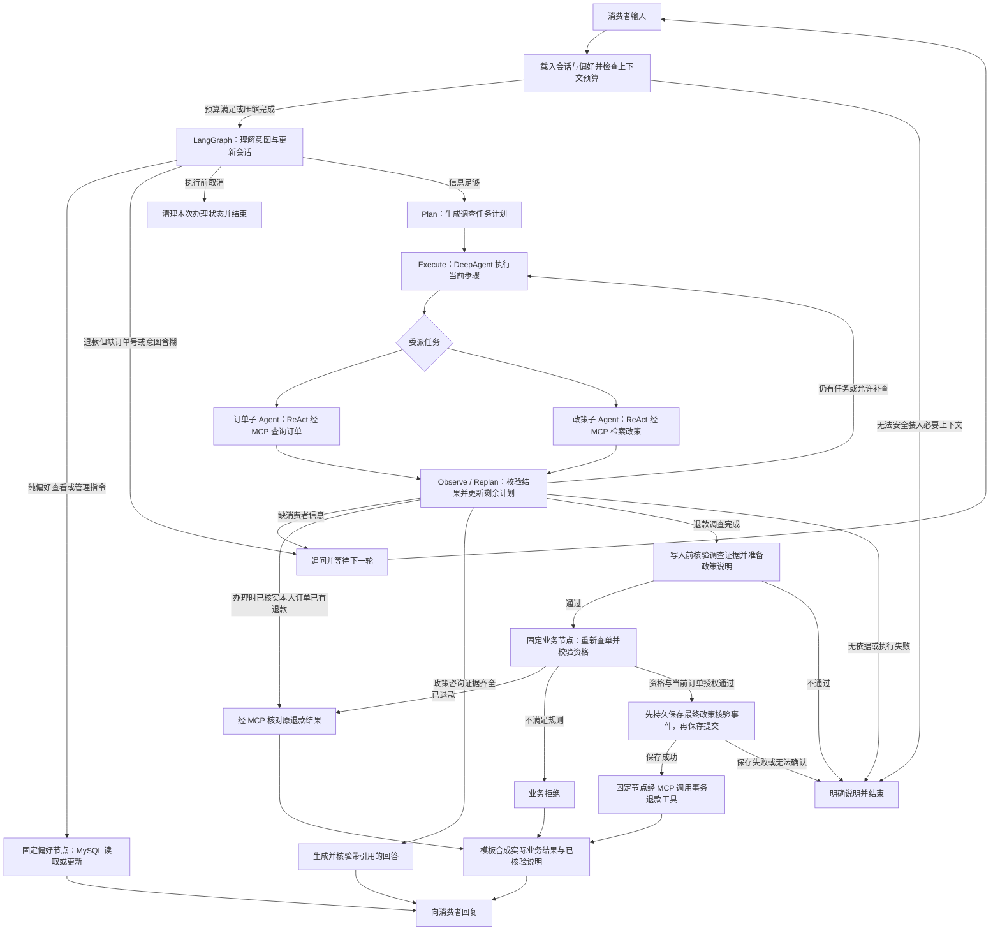

# 退款业务 Agent：五项技术与 MCP 组合演示设计

日期：2026-11-18  
性质：用户已确认的设计基线，退款应用尚未实施  
基线确认日期：2026-11-19  
政策知识源：[演示退款政策与常见问题](../../policy/refund-policy.md)

设计审阅：2026-11-19 独立 builder check 未发现仍需用户决定的重要业务或架构缺口，核心设计与 ADR 未发现实质矛盾；用户已在 Q9 确认整体设计基线，本轮设计访谈结束。框架、适配器、MySQL、Milvus 与完整业务链仍需后续实际实现和验收；设计确认不代表这些验证已经完成。

MCP 接入：用户已确认集群内采用“退款 Agent 服务 + MCP 工具服务”两个应用，退款业务工具通过 MCP，聊天、检查点、摘要和偏好由退款 Agent 直接使用 MySQL；具体契约和数据所有权见[MCP 接入设计](mcp-integration.md)及 [ADR-0006](../../docs/adr/0006-refund-agent-mcp-service-boundary.md)，尚未实施这两个应用。

存储修订：政策向量使用集群已有 Milvus；原始聊天、会话状态、显式长期偏好、模拟订单和退款记录使用 MySQL 持久化，见[存储与记忆设计](storage-memory.md)。用户已确认正常重启保留数据、显式操作才重置，替代“重启即重置”的旧约定；已选定的自动压缩策略见[上下文压缩设计](context-compression.md)。

提交修订：用户确认首版由会话管理发送前的办理意图。每次提交在发送前保存本次授权证据，原会话及模拟业务采用七张应用表。见[数据库设计](database-design.md)与 [ADR-0008](../../docs/adr/0008-refund-authorization-per-dispatch.md)。

政策修订：先让 Host 根据本轮 MCP 回执回答和核验引用，再接入 MySQL 政策发布目录，最后实现首次模拟退款。见[第 5 节](#5-rag-文档与检索流程)与 [ADR-0010](../../docs/adr/0010-refund-policy-publication-and-evidence.md)。

## 1. 意图与已确认范围

通过一个消费者退款对话，展示 LangGraph、ReAct、DeepAgent、Plan and Execute、RAG 如何在同一条业务流程中协作。五项技术全部使用，是本次教学设计的硬约束，不以最少技术数量为目标。

用户已确认：

- 退款演示的应用代码统一放在仓库根目录 `order-demo/`，包括退款 Agent、MCP 服务和 CLI。与现有 `mcp/workflow/` 和 `langgraph/` 演示互不依赖。
- 只做演示，不考虑生产接入；订单和支付接口允许模拟。
- 业务仅覆盖电商实物订单、未发货、整单原路退款。
- 消费者通过对话咨询和办理；意图明确且校验通过后直接调用模拟退款，无需人工审批。
- 资格与金额由业务代码校验；咨询不构成办理授权；缺订单号时先追问。
- 支持多轮补充订单号、执行前取消或更换订单，每次只处理一笔订单。
- 已退款返回原结果；正常办理直接返回模拟最终结果，不演示到账等待或进度轮询。
- 使用固定模拟消费者，不实现登录注册；只能操作自己的订单。
- 生成中文政策文档作为 RAG 知识源。普通咨询标明所选 FAQ 或正式条款的文档名称和条目编号，依据不足时明确说明。订单资格和退款办理引用正式条款。
- 退款执行前必须取得充分的适用政策依据；RAG 检索失败或依据不足时停止本次办理，说明原因，不改变订单或生成退款记录。
- 发起新退款前，Host 必须确认最终政策核验事件已持久保存。保存失败或无法确认时暂停本次新提交。查单、查看已有退款结果和核对旧提交照常进行。见 [ADR-0009](../../docs/adr/0009-refund-policy-evidence-before-dispatch.md)。
- 使用 CLI 多轮聊天展示消费者体验，另输出学习者查看的结构化过程日志，包含计划、DeepAgent 委派、ReAct 工具调用、RAG 命中条款和实际业务结果。
- 政策向量必须写入集群已有 Milvus；原始聊天完整保存在 MySQL，会话状态与长期偏好也用 MySQL 持久化。
- 长期偏好只保存消费者明确要求记住的稳定偏好，不自动将全部聊天提炼为长期事实，退款授权不跨会话继承。
- 正常重启保留聊天与业务状态，仅显式执行演示重置才恢复初始数据，替代原 Q16 的自动重置约定。
- 模拟订单与退款记录也存入 MySQL，同订单跨会话和跨重启重复申请均返回原退款记录。
- 由外层 LangGraph 按实际 token 预算自动压缩较早历史，保留近期完整交互及独立结构化状态，工具调用与对应结果成对处理；摘要失败且无法安全装入上下文时暂停本轮、保留数据，不继续执行退款。
- 消费者可在聊天中查看、更正和删除长期偏好，同类偏好采用最新明确指令；旧聊天、摘要或 checkpoint 不得重新启用已删除或被覆盖的偏好。
- 应用启动只恢复历史与待办，不自动继续未完成退款；消费者明确继续后重新查单、检索政策并校验，已有成功记录返回原结果。
- 显式演示重置只作用于本演示的聊天、摘要、偏好和模拟业务数据，并装载初始订单。保留政策发布目录及 Milvus 索引。政策更新使用独立发布流程。
- 原五项技术全部使用，并通过 Streamable HTTP 接入独立 MCP 服务的 get_order、search_policy、get_refund_result 和 submit_mock_refund；MCP 不改变模型只读调查、固定业务节点执行退款的权限边界。
- 模型仅接受自托管方案；选型优先保证中文多轮、工具调用与结构化输出稳定性，允许较慢响应。
- 运行退款演示时可以重新分配现有资源，旧演示应用可按需停用；这不等于本次选型已经执行服务变更。
- 复用集群已部署的 MySQL、Milvus、Qwen3-8B BF16、BGE-M3 FP16 和 BGE reranker。退款演示在已有 MySQL 实例上使用新数据库和新表，表结构见[数据库设计](database-design.md)。数据库端点及历史验收见[存储与记忆设计](storage-memory.md#7-已查到的环境证据)，模型端点见[模型选型与部署基线](model-selection.md)。退款政策使用专用 Milvus 集合。
- 用户已确认方案 A，使用现有 Qwen 的原生工具调用、观察回传和 json_schema。2026-11-19 的部署记录显示该接口已通过基础真实调用验收。集群入口的本轮复测结果见[环境证据](storage-memory.md#7-已查到的环境证据)。

反目标：不能将咨询当作授权，不能让模型自行确定金额或改变业务规则，不能将模拟成功说成真实到账，不能为同一订单重复产生退款。

## 2. 方案取舍与技术关系

访谈曾比较“显式流程 + RAG”和“显式流程 + 自主工具循环 + RAG”。前者不能满足用户后续提出的五项技术全部使用要求，因此本稿采用组合方案。

| 技术 | 本设计中的实际职责 | 可观察的使用证据 |
| --- | --- | --- |
| LangGraph | 外层状态、节点、分支、执行循环与多轮会话 | 节点事件、会话状态和流转记录 |
| Plan and Execute | 先生成只读调查计划，逐步执行，再基于工具观察继续、修订或结束 | 初始计划、每步结果、重规划决定 |
| DeepAgent | 使用官方 `deepagents` SDK 构建任务执行器，并委派订单、政策两类专用子 Agent | DeepAgent 调用与具名子任务事件 |
| ReAct | 执行器和专用子 Agent 内部按观察选择下一次工具行动 | 工具调用、工具结果和停止事件 |
| RAG | 从生成的政策文档检索相关条款，再生成带引用的回答 | 检索 query、命中条款、回答引用 |
| MCP | 连接独立退款工具服务，统一业务工具入口 | 工具发现、Schema 校验、真实跨进程工具调用及关联结果 |

它们属于不同层次：LangGraph 是编排运行时；Plan and Execute 是外层任务组织方式；DeepAgent 是执行器框架；ReAct 是内部工具交互方式；RAG 是政策检索与生成能力；MCP 是跨服务工具接入协议。集群以退款 Agent 与 MCP Server 两个应用实现组合，逻辑子 Agent 不分别部署。

外层 Planner 是全局计划的唯一来源。DeepAgent 可以管理当前步骤的局部任务，但不能修改外层已校验计划、退款授权或退款结果。ReAct 直接使用框架提供的模型与工具循环，不另套一层同功能 Agent 循环。使用 DeepAgent 不等于需要启用全部默认工具。

## 3. 主流程

正常退款样例的一次完整执行会经过原五项技术及新增 MCP。缺订单号、取消等分支无需强制触发所有技术。

## 4. 各节点的行为

### 4.1 理解意图与会话更新

输入为消费者文本、会话历史和可信运行上下文。模型输出受限的 `ConversationDecision`，业务节点负责更新状态。意图枚举为 `policy_question`、`refund_request`、`order_question`、`cancel`、`change_order`、`memory_request`、`out_of_scope`、`unclear`。偏好指令解析为可空的具名 `PreferenceCommand`，由固定应用节点执行，不放入调查计划或开放为任意写入工具；同句包含业务请求与偏好指令时分别记录其意图与实际结果，偏好不能创建退款授权或改变业务条件。

订单号缺失时保存待办，下一轮“DEMO-1001”可补齐后继续。一般性政策咨询不要求订单号。查询个人订单能否退款属于 `order_question`，查询并解释后结束，不执行退款。退款中途插入政策问题只回答该问题并保留原待办，不自动把回答政策问题转换成退款办理；下一轮消费者表示继续后再恢复。

外层会话节点在当前会话状态维护 `AuthorizedRefundIntent`。消费者更换订单时使旧办理意图失效并清除旧调查结果。如果消费者明确说“改退 DEMO-1002”，这条消息可以构成新订单的授权。固定退款节点校验通过并准备发送时，将本次授权证据写入提交记录。消费者编号只来自程序上下文。

取消在处理下一条消费者消息时生效：单次执行调用采用同步处理，模拟写入期间不承诺支持并发取消。未到写入阶段的待办可取消；已经成功的结果不能撤销。

#### 多轮上下文

聊天内容作为当前会话的上下文，包括消费者消息和 Agent 已回复的内容。消息与结构化会话状态改为按消费者及会话 ID 在 MySQL 中持久化；内存只承担运行时处理，不能作为唯一存储。历史消息帮助理解省略、指代、补充信息和意图延续；业务事实仍以工具结果为准。

例如“我要退款 → 请提供订单号 → DEMO-1001”应解释为对该订单的退款申请，而不是独立的订单号文本；如果期间消费者已取消待办，随后单独发送订单号不能恢复旧授权，需要重新明确办理意图。

上下文按职责提供：

| 调用方 | 使用的上下文 |
| --- | --- |
| 意图理解节点 | 当前输入、同会话相关历史消息、当前订单、待办与授权状态 |
| Planner / Replan | 从会话中解析的当前目标、结构化状态、已验证的步骤观察和剩余预算 |
| DeepAgent 与专用子 Agent | 当前任务及其所需问题、订单标识和已验证事实；不默认复制完整会话到每个子 Agent |
| PolicyAgent / RAG | 结合会话消解指代后的政策问题、必要的已验证订单状态及本次检索证据 |

原始聊天历史保存到 MySQL，与退款政策知识库分开管理。聊天中的“我已经付款”或“按我说的金额退”不能替代订单工具结果。执行前重新查询订单，不复用历史回复中的旧状态决定退款。

新会话不继承其他会话的办理授权，也不默认复制全部旧会话消息。MySQL 中的退款会话记忆用于同会话延续，消费者跨会话记忆只复用消费者明确要求记住的当前有效稳定偏好；正常重启保留记忆和业务记录，显式操作才重置。完整留库与当次模型输入分别管理，自动压缩由外层 LangGraph 统一管理；已删除偏好不能从旧消息、摘要或 checkpoint 再次启用。重启后恢复同会话历史与待办但不自动提交，消费者明确继续后重新获取订单与政策证据并核验；已有成功记录只返回原结果。具体流程见[存储与记忆设计](storage-memory.md)及[上下文压缩设计](context-compression.md)。

### 4.2 Plan：生成调查计划

Planner 根据当前问题和已知状态生成 `InvestigationPlan`，每个步骤具有 ID、任务类型、输入、依赖和完成条件。只允许 `inspect_order`、`retrieve_policy` 两类任务；不允许规划任意工具名称、代码或资金操作。

示例：

- “未发货能退款吗？”：检索资格与办理授权条款。
- “订单 DEMO-1001 能退吗？”：查询订单，再结合订单事实检索适用政策，解释后结束。
- “帮我退 DEMO-1001”：查询订单，再检索与订单状态相关的政策，完成后进入固定退款节点。
- “帮我退 DEMO-1003”：查询发现已退款后，重规划结束调查，由业务节点读取原结果，无需继续退款。

计划不是供展示的文字。执行器逐步消费经过 Schema 和依赖校验的计划，结果会影响剩余步骤。最终是否进入退款节点由外层业务条件决定，不能由 Planner 添加一个“退款步骤”绕过校验。

### 4.3 Execute：DeepAgent 与 ReAct

使用真实 `deepagents` SDK 创建一个调查执行器，配置两个专用子 Agent：

| 子 Agent | 可调用的业务工具 | 返回内容 |
| --- | --- | --- |
| OrderAgent | 经 MCP 的 `get_order` 只读适配器 | 经过工具读取的订单事实及来源事件 ID |
| PolicyAgent | 经 MCP 的 `search_policy` 只读适配器 | 命中条款、文档版本、相关依据或依据不足 |

执行器根据当前计划步骤委派给对应子 Agent，拿到结构化结果后立即返回外层图；当前步骤没有完成之前，不自行开启后续计划步骤。监督层不开放额外业务工具，且显式配置默认通用子 Agent 的权限或禁用默认通用子 Agent。不得借默认子 Agent 间接获得退款、Shell、网络浏览或宿主文件写入权限。

每个子 Agent 在内部执行 ReAct 工具循环：选择可用工具和参数、获取观察、决定补充查询或完成。这里保留工具行为和结果记录，不要求模型公开内部逐字推理，不用生成的“思考文本”冒充实际调用证据。

DeepAgent 只读调查；`submit_mock_refund` 不注册给调查执行器或任何子 Agent。该业务操作由固定 LangGraph 节点经受控 MCP 调用执行，MCP Server 也按调用身份限制写入；模型工具列表限制不能替代服务端权限检查。

### 4.4 Observe / Replan：执行结果驱动后续流程

先验证子任务输出与真实工具事件一致，再让外层根据观察决定继续、修订剩余只读计划、请求消费者补充信息或结束。发现订单不可操作时停止后续订单调查，不披露未授权订单信息；资格拒绝和已退款分支允许缩短计划。

政策检索无充分依据时，允许一次带明确目标的 query 改写；仍无依据则停止该政策问题并说明。用户更换订单后丢弃旧计划并新建计划，不在旧计划上替换订单号后沿用旧证据。

建议边界：初始计划最多 3 步，外层最多修订 2 次，单步最多 3 次业务工具调用，单次用户输入总计最多 8 次业务工具调用。全部预算由外层代码执行并跨子 Agent 汇总，超限后明确停止，不靠提示词约束无限循环。具体参数是设计者建议，用户可调整。

### 4.5 固定退款节点

固定节点依据可信上下文经 MCP 重新查询订单，核验当前会话的办理意图和本次政策依据。确需新执行时，先持久保存最终政策核验事件，再保存带授权证据的提交记录，确认两次保存成功后调用 MCP 退款工具。Server 在 MySQL 事务内按幂等键锁定提交记录，再锁定订单，复核归属、提交及授权状态、已有退款、支付与发货状态，使用订单实际支付金额执行整单退款。MCP Server 写入订单和退款业务表。

处理优先级：归属不可操作 → 已有退款则返回原结果 → 未支付拒绝 → 已发货拒绝 → 检查当前订单办理授权 → 写入模拟退款。重复申请只能返回原退款记录，不生成新单。

每个订单仅一笔成功退款，以 MySQL 业务记录的唯一性约束保证，更换会话、换幂等请求号或重启应用也不能绕过。成功结果包括订单号、人民币整数分金额、模拟退款单号、`SIMULATED_SUCCEEDED`；用户输入金额或收款渠道不参与计算。

### 4.6 回答

普通政策咨询标明所选 FAQ 或正式条款的文档名称、版本和条目编号。订单与退款事实来自业务工具事件。退款的政策说明在写入之前依据正式条款生成并核验，证据不合法时不得进入写入节点。成功结果使用确定性模板呈现订单、金额和模拟退款单号，可附事先已核验的政策说明；写入成功后不再调用模型生成或修改该业务结果。

引用必须来自本次调查的成功检索回执。Host 核对事件 ID、文档 ID、版本、条目编号和条目类型，并从对应回执取标题与原文。普通咨询可引用适用 FAQ，供订单资格或退款办理使用的政策依据须为正式条款。用问答验收集检查候选是否支持答复，引用核验负责确认出处。

最终业务复核可能发现订单在调查后已改变状态，此时丢弃不再适用的预生成说明，按实际业务结果使用确定性模板回复。写入后若展示阶段异常，保留已成功退款记录，不把已成功业务改写为失败，也不重复提交；后续同订单申请返回原结果。

## 5. RAG 文档与检索流程

政策原文由权威文档源维护。FAQ 独立录入问题和答案，政策切分和条目主键由发布流程管理。第一步复用[演示退款政策](../../policy/refund-policy.md)的 `1.0`，含 14 条正式条款和 7 条 FAQ。第二步支持分别发布多份文档的版本。发布命令读取原文并同步集群 Milvus，Host 运行时从 MCP 回执读取条目。见 [ADR-0010](../../docs/adr/0010-refund-policy-publication-and-evidence.md)。

### 5.1 检索、补查与答复

普通咨询经 `search_policy` 在 Milvus 同时召回 FAQ 和正式条款，合计最多 8 条，BGE reranker 统一重排后返回前 3 条。办理退款从召回开始只查正式条款。首次成功检索即返回目录修订号，包括空结果。本次退款调查的后续检索和引用核验沿用该政策版本快照，新调查重新读取生效版本。

Host 让全部重排候选参与选答。模型从中选出最能直接回答问题且适用条件一致的一条，也可以判断全部不适用。选中已发布 FAQ 时展示其答案正文并引用 FAQ 本身，选中正式条款时展示该条款的原文和出处。首轮成功但所有候选均不适用时，用消费者问题及必要的已核验订单事实，在同一目录修订内再做一次仅限正式条款的语义检索。补查仍无足够依据时提示依据不足，检索失败时提示暂时无法核实政策。

实际部署的 BGE 返回未归一化向量。MCP 服务内的 RAG 代码对文档和 query 同时做 L2 归一化，以内积实现余弦相似度；拒绝维度错误、非有限值和零模向量。政策文档入库命令复用同一向量化规则；重建政策索引并按当前向量与相似度重新校准阈值，不沿用历史流程路由的分数阈值，不修改已部署 BGE 服务。

检索是实际运行的相似检索，不写死问题与答案映射，也不把整个文件直接塞入上下文冒充检索。文档是知识数据，不能向模型发出新的指令；文档不能开放工具权限、修改身份、授权退款或决定金额。

阈值由所选 embedding、重排模型和正反例校准，不在设计阶段给一个跨模型通用阈值。退款政策 collection 只收录政策文档，不收录消费者订单、模型推理或执行计划。使用集群已有 Milvus 与 BGE reranker。重排服务超时或失败时，本次政策检索返回失败，不使用未重排的候选代替成功结果。咨询时说明暂时无法核实政策；办理时停止本次退款写入。查单、查看已有退款结果和核对旧提交照常进行。

### 5.2 发布、重试与资格规则

发布流程将 Markdown 按正式条款和 FAQ 分块，经同一编码规则写入 Milvus。MySQL 政策发布目录记录各文档的生效版本和发布历史，按目录修订号保留版本组合。发布命令接收具体文档和版本，FAQ 以问题与答案独立录入。完整写入后读回比对条目清单与内容，并验证正常检索，随后在 MySQL 事务中切换该文档的生效版本及目录修订。若该文档的生效版本被并发发布改变，报告冲突。各文档可独立发布，条款因新版删除后退出新调查的检索范围。

版本首次生效前，可修正原件并沿用版本号重发。重试前从发布记录确认该版本从未生效、上次写入已经结束，同版本串行清理和写入。按文档 ID 和版本清理残留，确认清空后全量重发。正式生效后的条款修订须发布新版本。已生效的历史版本保留，用于已有调查和引用追溯。

前两步沿用代码确定的订单资格结果，资格依据来自演示退款政策在本次快照中的版本。发布命令记录发布者对资格行为的确认。会改变资格的政策须与同版本的结构化规则一起生效，由代码依据订单事实计算资格。

### 5.3 交付顺序

1. [15 移除 Host 的政策文件依赖](issues/15-remove-host-policy-file-dependency.md)。配套升级 Host 与 MCP，复用现有 Milvus 集合和演示 `1.0` 跑通政策版本快照、普通咨询共同选答、正式条款语义补查和引用核验。升级后恢复未完成的调查时重新检索政策取得快照。
2. [16 建立政策发布目录并支持多文档版本切换](issues/16-publish-policy-catalog-revisions.md)。MCP 从 MySQL 获取生效版本，沿用 15 的工具契约，多文档候选按完整身份区分。前两步验收后继续 [07 首次模拟退款](issues/07-submit-one-mock-refund.md)。

## 6. 输入输出与状态契约

实现时优先使用具名 Pydantic 模型约束不可信输入和模型输出；下表定义业务语义，不在本文写实现代码。模型输出禁止额外字段，明确枚举和可空字段；金额使用人民币整数分。框架已提供的消息和状态类型直接复用。

| 模型 | 必需语义 |
| --- | --- |
| `ConversationDecision` | 意图枚举；可空的订单号；消费者是否明确办理；可空政策问题；缺失信息说明；可空 PreferenceCommand，不能用偏好指令替代办理授权 |
| `PreferenceCommand` | list / set / delete；set 必须有允许的偏好键和新值，delete 必须指明允许的键，list 不携带写入值；消费者身份由可信上下文提供，模型不能指定其他消费者 |
| `PreferenceResult` | listed / updated / deleted / failed；只有实际持久化成功才能回复更新或删除成功，失败不能带成功声明；读取仅返回当前消费者有效偏好 |
| `AuthorizedRefundIntent` | Host 维护的会话内结构化意图，包含可信消费者、当前会话、当前订单、明确授权的来源消息和有效状态。固定节点在提交时保存本次授权证据 |
| `InvestigationPlan` | 具名步骤列表；步骤类型仅允许 inspect_order / retrieve_policy；依赖必须存在且无环 |
| `TaskObservation` | 步骤 ID；completed / needs_input / no_evidence / failed；具类型的订单结果或政策证据；真实工具事件 ID |
| `ReplanDecision` | continue / revise / clarify / finish / fail；与分支匹配的剩余计划或说明，结束时不能留未完成必需步骤 |
| `OrderQueryResult` | found 时有本人订单，含支付/发货/退款状态和金额；unavailable 时不含订单详情；failed 时含可展示错误摘要 |
| `PolicySearchResult` | 检索状态、事件 ID、目录修订号和重排候选，含文档 ID、标题、版本、条目编号、条目类型和原文 |
| `PolicyEvidence` | 原始问题、检索 query、sufficient / insufficient，以及与本轮成功回执匹配的正式条款引用和原文 |
| `RefundLookupResult` | found / not_found / unavailable；found 才携带已经核对的原退款结果，not_found 不证明之前提交必定未发生 |
| `RefundResult` | simulated_succeeded / already_refunded / denied / failed / unconfirmed；成功与原成功记录必须有订单、金额和原退款单号；拒绝、明确失败与结果未确认不得带成功凭据，unconfirmed 不等于未写入 |

工具与业务调用边界：

- MCP `get_order(order_id)`：消费者身份从经认证的调用上下文取得，返回 `OrderQueryResult`。
- MCP `search_policy`：接收查询、由 Host 确定的检索范围和可选目录修订号，返回 `PolicySearchResult`。Host 依据回执核验普通咨询的出处和正式政策依据。
- MCP `get_refund_result(order_id, business_ref=None)`：订单号必填，业务标识可空且由 Host 提供；仅固定业务节点调用，按本人订单核对原记录，返回 `RefundLookupResult`，不进行写入。
- MCP `submit_mock_refund(order_id, idempotency_key)`：仅固定业务节点调用，幂等键由 Host 生成。服务端按键读取提交携带的授权证据，并核对可信消费者和订单，返回 `RefundResult`。

格式、枚举和对象内一致性归数据模型校验；归属、订单实际状态、真实金额和退款唯一性归业务服务校验；引用与工具事件真实性归外层图验证。

会话状态至少保留消息、当前订单、待办意图、当前订单授权、计划、步骤观察、政策证据、预算和退款结果。每轮只允许一笔活跃订单。新订单不能复用原订单授权、计划或事实。

## 7. 演示数据与完整案例

固定消费者为 `DEMO-USER-01`。以下金额与编号为设计者提供的演示样例：

| 订单号 | 归属 | 支付状态 | 发货状态 | 退款状态 | 实付金额 |
| --- | --- | --- | --- | --- | --- |
| DEMO-1001 | 当前消费者 | 已支付 | 未发货 | 未退款 | ¥199.00 |
| DEMO-1002 | 当前消费者 | 未支付 | 未发货 | 未退款 | ¥0.00 |
| DEMO-1003 | 当前消费者 | 已支付 | 未发货 | 已退款 | ¥88.00 |
| DEMO-1004 | 当前消费者 | 已支付 | 已发货 | 未退款 | ¥299.00 |
| DEMO-2001 | 其他消费者 | 已支付 | 未发货 | 未退款 | ¥59.00 |

主案例：

1. 消费者：“我要退款。”图识别申请意图，追问订单号。
2. 消费者：“DEMO-1001。”图关联上轮办理意图，在当前会话将授权绑定到该订单。
3. Planner 产生“查询订单 → 检索适用政策”的调查计划。
4. DeepAgent 委派 OrderAgent；其 ReAct 循环调用 `get_order`，观察到本人订单、已支付、未发货、实付 19900 分。
5. Replan 基于该观察继续政策调查，形成针对未发货整单退款的检索输入。
6. DeepAgent 委派 PolicyAgent；其 ReAct 循环调用 `search_policy`，RAG 返回 RF-003、RF-005、RF-007 等条款。
7. 图校验证据及预生成的政策说明，确认调查完成，进入固定业务节点。
8. 模拟退款服务原子复核并创建唯一退款记录。
9. 回复：“模拟退款成功。订单 DEMO-1001，退款金额 ¥199.00，模拟退款单号 MOCK-RF-1001。依据：《演示退款政策与常见问题》RF-003、RF-005、RF-007。”

实际检索命中和模拟退款单号以运行结果为准；主案例里的命中列表和编号是展示样例，不写死为所有查询结果。

## 8. 异常和边界

| 情形 | 预期行为 |
| --- | --- |
| 仅询问能否退款 | 查询与解释，绝不提交退款 |
| 缺订单号 | 追问，保留待办 |
| 多笔订单 | 请消费者先选一笔，不批量办理 |
| 非本人或不存在的订单 | 统一提示不可操作，不返回他人事实 |
| 已退款 | 读取并返回原记录，不产生第二笔退款 |
| 未支付或已发货 | 业务拒绝，解释实际原因 |
| 执行前取消或换单 | 清理或替换待办及其授权和证据 |
| 未覆盖的政策问题 | 检索与有限补查后明确“当前政策文档未说明” |
| 政策与业务规则冲突 | 明确冲突并停止本次办理，不让模型自行择一 |
| 退款所需政策证据缺失 | 停止本次办理并解释缺少政策依据，不改变订单或生成退款记录；用户已确认 |
| 最终政策核验事件保存失败或无法确认 | 暂停本次新提交，提示依据记录暂不可用。查单、查看已有退款和核对旧提交照常进行 |
| 写入前的子 Agent 输出、计划或证据引用非法 | 本轮失败并保留已发生事件，不执行退款 |
| 订单查询或 RAG 工具失败 | 说明调用失败，不伪装为订单不存在或政策拒绝 |
| 模拟退款明确失败 | 回复失败，不自动重试写入 |
| MySQL 提交结果无法确认 | 按唯一业务标识核对原退款记录；仍无法核实时说明结果未确认，不自动重发，也不声称一定未写入 |
| 退款写入后展示失败 | 保留成功记录，不重做业务；再次办理时返回原结果 |
| 达到调用预算 | 停止并说明本轮未完成；只能报告已验证结果 |

模拟退款写入使用 MySQL 事务。提交回执丢失时按订单和唯一业务标识核对原记录。查到已有退款则返回原结果。暂时查无结果须明确说明待核对，并拦截所有会话针对该订单的新提交。确认旧提交未产生退款并已关闭后，消费者可在原会话明确继续以恢复待办，也可在新会话明确指定订单并要求办理以发起新申请。两条路径均重新校验订单、政策依据和授权，以新幂等键创建提交，并引用当前会话的本次指令。其他订单照常处理。见 [ADR-0007](../../docs/adr/0007-refund-unconfirmed-dispatch.md)。

## 9. 验收

验收围绕行为与可观察事件，不用生成的解释文字代替调用记录：

1. 完整退款案例真实经过 LangGraph 节点、Planner 计划、DeepAgent 子任务、ReAct 工具调用和 RAG 条款检索。
2. 政策咨询和个人订单资格咨询均不产生退款写入。
3. 缺订单号可以同会话补充，换单清除旧授权，执行前取消有效。
4. 非本人、未支付、已发货、已退款、重复申请均符合预期；同订单跨会话与跨重启重复申请仍返回原单。
5. 退款金额来自订单，消费者要求改金额或改收款账户不能生效。
6. 普通政策咨询从全部重排候选选择适用的 FAQ 或正式条款，引用本次回执里的实际条目。订单资格与办理使用正式条款，未知问题明确提示依据不足。
7. 写入前出现非法计划、伪造证据引用、工具失败或调用超限时，不发生退款写入；写入后展示失败不改变成功记录且不重复提交。
8. 过程记录足以区分计划、实际工具事件、重规划、规则判定和最终结果；消费者回答简洁，不展示内部执行细节。
9. 自动压缩后仍正确处理取消、换单和未完成工具往返；摘要来源与近期消息不重不漏，超窗失败不触发退款。
10. 偏好查看、更正、删除均按实际 MySQL 结果回复，删除或覆盖后的偏好不能从历史摘要或 checkpoint 恢复生效。
11. 业务工具真实通过 MCP 跨进程调用，调查身份不能执行退款，Host 不绕过 MCP 修改订单退款记录；返回丢失时只能核对，不由适配器自动重发写入。
12. 写入前校验未通过时，办理意图只留在当前会话状态。撤销已保存提交的授权时，结果仍待核对的订单继续被拦截。维护关闭旧提交后，原会话明确继续、新会话明确申请均可开启新办理，各自的新提交引用当前会话的本次指令。没有本会话待办时，单独说“继续”须先明确订单和办理意图。
13. 核对最终政策核验事件先于新提交保存成功，且可从成功退款的提交键和 `trace_id` 查到实际采用的版本、条款和检索事件。模拟该事件保存失败或无法确认时，没有新的退款提交记录或写调用，查单、查看已有退款结果和核对旧提交仍可执行。

未实施，当前不声称运行或测试已通过。

## 10. 设计者建议与交给实现者的选择

以下尚未由用户逐项确认，不能写作用户既定要求：

- 两类 MCP 调用身份分别服务于只读调查和固定节点执行。凭据注入与连接管理由实现者按已确认的两服务边界选择。具体设计见[MCP 接入设计](mcp-integration.md)与[数据库表结构](database-design.md)。
- RAG top-3、预算上限、模拟订单金额、本文新增的“不设退款期限、不收手续费”属于本稿演示默认值。

使用已部署 Qwen3-8B 承担生成与工具决策，BGE-M3 承担向量化。原生工具与 Schema 接口已上线并完成基础真实调用验收。具体节点映射见[模型与部署基线](model-selection.md)，协议边界见[接口设计](integration-contracts.md)，验收证据见部署记录（`D:/Redemption/Redemption/K8S/qwen3-native-tools-schema-plan-20261118/DEPLOYMENT-RESULT.md`）。

实现者可决定文件拆分、符合已确认存储方向的 checkpointer / 记忆存储适配器、Milvus 字段与索引配置、embedding 适配器、提示词措辞、日志编码和 ID 生成方式，但必须满足契约、权限边界、完整五项技术调用证据与验收行为，不能自行换回内存存储。

现有 ADR-0001 和 ADR-0002 针对已有组合演示，本稿不修改它们，也不自动继承其协议和配置策略。

## 11. 技术依据

以下仅用于框架能力说明；本稿的业务规则和预算是教学设计，不来自官方示例：

- [LangGraph 概览](https://docs.langchain.com/oss/python/langgraph/overview)：状态、节点、边及确定性与模型步骤混合编排。
- [Workflows and agents](https://docs.langchain.com/oss/python/langgraph/workflows-agents)：固定工作流与动态 Agent 的区别。
- [Deep Agents 概览](https://docs.langchain.com/oss/python/deepagents/overview)：SDK、任务规划、子 Agent 与上下文管理。
- [Deep Agents 定制](https://docs.langchain.com/oss/python/deepagents/customization)和[子 Agent](https://docs.langchain.com/oss/python/deepagents/subagents)：领域工具、结构化结果和专用子 Agent。
- [ReAct 原始论文](https://arxiv.org/abs/2210.03629)：行动与环境观察交替的任务处理方法。
- [Retrieval](https://docs.langchain.com/oss/python/deepagents/retrieval)：检索外部知识并结合生成的 RAG 流程。

## Comments

2026-11-18：依据本轮 grilling 访谈生成。最初允许按业务取舍，用户随后明确改为五项技术全部使用；以后一要求为准。本稿仅供设计审阅，未编写产品代码、安装依赖或启动服务。

2026-11-18：独立 builder check 指出“写入后才核验解释引用”与“非法引用不得写入”存在时序冲突。现将退款政策说明的生成与证据核验前移到写入之前，写入后仅做确定性模板合成。该修订为设计者作出的流程一致性选择，未新增业务权限。

2026-11-18：用户在 Q14 明确同意退款前必须有充分政策依据，RAG 检索失败或依据不足时停止办理并说明原因；已从待确认建议移入已确认范围，并同步到政策 RF-013。

2026-11-18：用户同意 Q15 的 CLI 聊天与独立过程日志，以及 Q16 的运行期间保留状态、重启后重置数据。用户询问聊天内容是否也作为多轮上下文；第4.1节补充会话历史、结构化状态、工具事实和政策证据的分层使用，明确会话隔离与业务记录共享的区别。

2026-11-18：用户随后明确政策向量必须进入集群已有 Milvus，并要求重新考虑聊天的短期、长期记忆在 MySQL 中的存储。本轮替换纯内存设计，新增 storage-memory.md 与 ADR-0004；Q16 的自动重置约定标记待重审，不再作为默认启动行为。

后续存储访谈：用户确认原始聊天完整保存、仅显式稳定偏好进入长期记忆、正常重启保留数据，以及模拟订单和退款记录也存 MySQL。已替代 Q16 的自动重置约定，并新增 context-compression.md 讨论模型输入压缩；MySQL 提交结果不明与明确失败分开处理，避免继续沿用纯内存时代的异常假设。

2026-11-19：用户确认自动压缩及超窗暂停边界，和聊天中的长期偏好查看、更正、删除。已将相应内容移入确认范围，新增偏好命令契约和验收行为，并记录 ADR-0005；重启后未完成退款的恢复方式与显式重置范围尚待决定。本轮只改设计文档。

2026-11-19：用户确认重启只恢复历史与待办、明确继续后重新校验，显式重置仅影响本演示并保留政策索引；同时要求引入 MCP，并询问集群中两个 Agent 的理解。文档按“两个应用服务：退款 Agent 与 MCP Server”提出接入草案，MCP Server 不必运行自主模型，具体工具与存储职责待本轮确定。

2026-11-19：用户确认 Q8 的 MCP 业务工具与 Host 会话存储分工。两服务拓扑、四个工具与结果契约已同步，新增 ADR-0006；检索候选与 Host 政策证据分层，授权及发送记录的落实方案标为设计者选择。准备对整套设计进行独立 builder check，本轮尚未编写退款应用代码。

2026-11-19：独立 builder check 完成，结论为 nothing important left，未发现仍需用户决定的业务或架构缺口，五份核心设计与相关 ADR 未发现实质矛盾，现有信息足以制定实施计划。工具、结果契约、相对文档链接及 Markdown 代码围栏检查已通过；此结论不代表退款应用实现、SDK 兼容性、持久化恢复或集群业务验收已通过。

2026-11-18：模型选型访谈 Q17–Q19 确认仅自托管、稳定性优先，以及允许为退款演示重新分配已有资源；实际模型、协议和容量建议另记 model-selection.md，不将推荐型号写成用户已经选定的决定。

2026-11-18：用户提供外部 Qwen3-8B 与 BGE-M3 部署结果，已同步实际 TP2 GPU 布局、基础检查范围和未归一化向量语义；旧单卡 Qwen / CPU BGE 建议不再作为现状。接口对接方式待本轮 grilling 决定，本轮未修改模型服务。

2026-11-18：用户明确同意方案 A；已同步接口决定，记录 ADR-0003 与接口实施计划。外部说明经版本文档核对，required 不列为当前 V1 首轮承诺；金额、身份、资格和退款写入仍由业务代码控制。

2026-11-19：用户授权切换后，Qwen 原生工具和 Schema 接口通过真实调用验收，BGE 健康及并行向量检查通过。退款业务 Agent 本身仍待实现。

2026-11-19：用户明确同意 Q9，将本版文档作为已确认设计基线；本轮 grilling / domain-modeling 设计访谈结束。主设计、MCP、存储记忆及上下文压缩文档已统一标记基线确认，业务与架构决定按本文及 ADR 执行，SDK、表名、适配器和部署参数等已委托细节留给实施者核实；本轮不自动启动退款应用编码、建表、向量入库或集群部署。

2026-11-19：用户补充复用已部署的集群数据库与模型，指定退款演示代码统一放在 `order-demo/`。已核对既有聊天、Agent 配置和 Redemption 的验收与部署记录，将连接端点、现有数据归属和本轮复测结果写入存储设计。

2026-11-19：用户确认环境和数据库信息可作为本阶段前提，无需再次测试，并要求在现有 MySQL 实例上为退款演示新建数据库和表。库名、表结构和约束在 `database-design.md` 中讨论，本轮未执行 DDL。

2026-11-19：用户确认金额按整数分存储，每笔订单至多产生一笔成功退款，失败和待核对记录留在提交表。已确认结果待核对时拦截该订单的新提交，过程诊断使用结构化日志及 `trace_id` 关联。

2026-11-19：用户确认专用库名 `order_demo`，两个服务共用一套数据库账号配置，统一引用 `order-demo/model/` 中的表定义和连接代码。订单与退款业务仍经 MCP 调用。模块分工见[数据库表结构](database-design.md)。

2026-11-19：用户确认由维护命令核对并关闭未产生退款的旧提交，通过事务阻止迟到请求，消费者明确继续后才重新核验和提交。八张应用表与提交状态作为首版数据库设计基线，LangGraph 检查点的框架表随 MySQL 适配器确定。

2026-11-19：用户确认每条退款提交自带一次办理的授权证据。准备发送前由当前会话管理办理意图，旧提交关闭后以消费者本次明确继续的消息作为新提交的授权来源。首版合并授权与提交记录，应用表调整为七张，见 [ADR-0008](../../docs/adr/0008-refund-authorization-per-dispatch.md)。

2026-11-19，用户确认旧提交关闭后，新会话可凭明确指定订单的办理指令发起新申请。用户同时确认最终政策核验事件须在新退款提交前持久保存。保存失败时，新提交暂停，查单、查看已有结果和核对旧提交照常进行。见 [ADR-0007](../../docs/adr/0007-refund-unconfirmed-dispatch.md) 和 [ADR-0009](../../docs/adr/0009-refund-policy-evidence-before-dispatch.md)。
